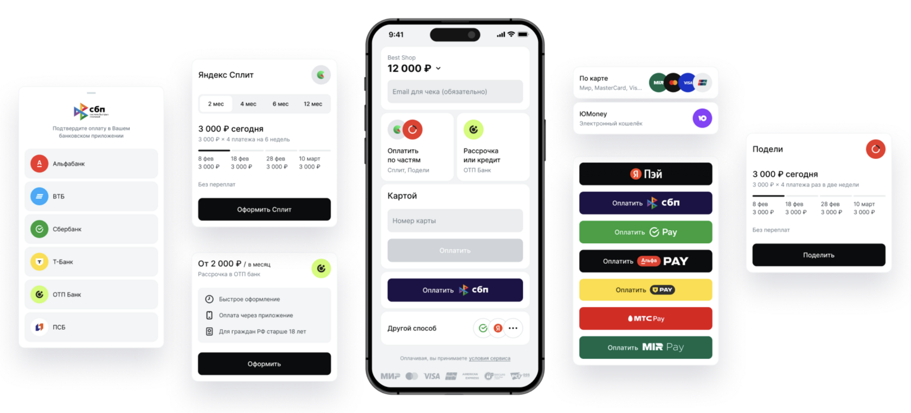

  
 ПОЛЕЗНОЕ ДЛЯ ВАШЕГО БИЗНЕСА

  <h2 class="home-hero__title">Robokassa — всё для приёма платежей и роста бизнеса.</h2>
  
Приём онлайн-платежей, платёжные методы, инструменты для бизнеса и инструкции по подключению — в одном месте.

  

    <a class="md-button md-button--primary" href="/docs/priem-platezhey/platezhnye-metody/">Изучить платёжные методы →</a>
    <a class="md-button home-hero__secondary" href="/docs/integratsii/">Готовые интеграции</a>
  

  
Информация о сервисе · Возможности · Подключение

БЫСТРЫЙ ДОСТУП

## С чего начнём? {: #quick-start }

Выберите раздел под текущую задачу.

  <a class="home-nav-card home-nav-card--featured" href="/docs/priem-platezhey/platezhnye-metody/">
    
      <svg viewBox="0 0 24 24" fill="none" stroke="currentColor" stroke-width="2" stroke-linecap="round" stroke-linejoin="round"><polyline points="23 7 13.5 16.5 8.5 11.5 1 19"></polyline><polyline points="17 7 23 7 23 13"></polyline></svg>
    
    ПРОДУКТ
    <strong>Приём платежей</strong>
    Карты, СБП, pay-сервисы, рассрочки и другие способы оплаты.
    Посмотреть методы →
  </a>
  <a class="home-nav-card" href="/docs/priem-platezhey/funktsii/">
    
      <svg viewBox="0 0 24 24" fill="none" stroke="currentColor" stroke-width="2" stroke-linecap="round" stroke-linejoin="round"><line x1="4" y1="21" x2="4" y2="14"></line><line x1="4" y1="10" x2="4" y2="3"></line><line x1="12" y1="21" x2="12" y2="12"></line><line x1="12" y1="8" x2="12" y2="3"></line><line x1="20" y1="21" x2="20" y2="16"></line><line x1="20" y1="12" x2="20" y2="3"></line><line x1="1" y1="14" x2="7" y2="14"></line><line x1="9" y1="8" x2="15" y2="8"></line><line x1="17" y1="16" x2="23" y2="16"></line></svg>
    
    ВОЗМОЖНОСТИ
    <strong>Функции Robokassa</strong>
    Мультибанкинг, платёжные ссылки, холдирование, подписки и сплитование.
    Изучить функции →
  </a>
  <a class="home-nav-card" href="/docs/podklyuchenie/ip/">
    
      <svg viewBox="0 0 24 24" fill="none" stroke="currentColor" stroke-width="2" stroke-linecap="round" stroke-linejoin="round"><line x1="12" y1="5" x2="12" y2="19"></line><line x1="5" y1="12" x2="19" y2="12"></line></svg>
    
    СТАРТ РАБОТЫ
    <strong>Подключение</strong>
    Инструкции для ИП, ООО и самозанятых, а также требования к ресурсам.
    Перейти к подключению →
  </a>
  <a class="home-nav-card" href="/docs/instructions/lk-robokassa/">
    
      <svg viewBox="0 0 24 24" fill="none" stroke="currentColor" stroke-width="2" stroke-linecap="round" stroke-linejoin="round"><path d="M14 2H6a2 2 0 0 0-2 2v16a2 2 0 0 0 2 2h12a2 2 0 0 0 2-2V8z"></path><polyline points="14 2 14 8 20 8"></polyline><line x1="16" y1="13" x2="8" y2="13"></line><line x1="16" y1="17" x2="8" y2="17"></line><polyline points="10 9 9 9 8 9"></polyline></svg>
    
    ПОШАГОВО
    <strong>Инструкции и обучение</strong>
    Вывод средств, платёжные ссылки, возвраты, уведомления и настройки ЛК.
    Открыть инструкции →
  </a>
  <a class="home-nav-card" href="/docs/priem-platezhey/fz-54/">
    
      <svg viewBox="0 0 24 24" fill="none" stroke="currentColor" stroke-width="2" stroke-linecap="round" stroke-linejoin="round"><polyline points="20 6 9 17 4 12"></polyline></svg>
    
    ФИСКАЛИЗАЦИЯ
    <strong>Чеки и 54-ФЗ</strong>
    Робочеки, облачная касса и интеграции с внешними кассовыми сервисами.
    Разобраться с чеками →
  </a>
  <a class="home-nav-card" href="/docs/integratsii/">
    
      <svg viewBox="0 0 24 24" fill="none" stroke="currentColor" stroke-width="2" stroke-linecap="round" stroke-linejoin="round"><polyline points="16 18 22 12 16 6"></polyline><polyline points="8 6 2 12 8 18"></polyline></svg>
    
    ТЕХНОЛОГИИ
    <strong>Интеграции и API</strong>
    Готовые решения для CMS, CRM и других платформ, а также документация API.
    Найти интеграцию →
  </a>

  
i

  
<strong>Не знаете, с чего начать?</strong> Если вам нужно узнать, какие способы оплаты мы поддерживаем, откройте раздел «Приём платежей». Если хотите изучить конкретные возможности для вашего бизнеса — начните с «Функций Robokassa».

О КОМПАНИИ

## О Robokassa {: #about-robokassa }

  

    
<strong>Robokassa</strong> — это сервис для приёма онлайн-платежей на сайте, в мобильном приложении или через мессенджеры. Мы обеспечиваем безопасность транзакций, автоматическую фискализацию по 54-ФЗ и поддерживаем все популярные способы оплаты.

    
Технология <a href="/docs/priem-platezhey/funktsii/multibanking/">мультибанкинга</a> гарантирует стабильность проведения платежей даже при пиковых нагрузках. Чтобы увидеть, как работает оплата, откройте демонстрационный магазин.

    

      <a href="https://docs.robokassa.ru/demoshop/" target="_blank" rel="noopener noreferrer" class="md-button md-button--black">Демонстрация платёжной формы ↗</a>
      В магазине нажмите «Перейти к оплате»
    

  

  

ЦИФРЫ И ФАКТЫ

## Ключевые показатели {: #metrics }

  

    
20+

    
лет на рынке

  

  

    
99,9%

    
заявленная стабильность платежей

  

  

    
PCI DSS

    
сертификация Level 1

  

  

    
24/7

    
поддержка клиентов

  

ПРЕИМУЩЕСТВА

## Почему Robokassa {: #why-robokassa }

  

    

      <svg viewBox="0 0 24 24" fill="none" stroke="currentColor" stroke-width="2" stroke-linecap="round" stroke-linejoin="round"><path d="M7 21V4h5.5a4.5 4.5 0 0 1 0 9H7"></path><line x1="4" y1="15" x2="16" y2="15"></line><line x1="4" y1="18" x2="16" y2="18"></line></svg>
    

    

      <h3>Понятная модель оплаты</h3>
      
Подключение без абонентской платы: комиссия взимается за успешные платежи согласно условиям тарифа.

    

  

  

    

      <svg viewBox="0 0 24 24" fill="none" stroke="currentColor" stroke-width="2" stroke-linecap="round" stroke-linejoin="round"><polygon points="13 2 3 14 12 14 11 22 21 10 12 10 13 2"></polygon></svg>
    

    

      <h3>Быстрый старт</h3>
      
Регистрация и настройка помогают пройти путь от заявки до приёма платежей без лишних сложностей.

    

  

  

    

      <svg viewBox="0 0 24 24" fill="none" stroke="currentColor" stroke-width="2" stroke-linecap="round" stroke-linejoin="round"><polyline points="23 7 13.5 16.5 8.5 11.5 1 19"></polyline><polyline points="17 7 23 7 23 13"></polyline></svg>
    

    

      <h3>Разные способы оплаты</h3>
      
Карты, СБП, платёжные сервисы и решения для оплаты частями — доступность зависит от подключения и условий.

    

  

  

    

      <svg viewBox="0 0 24 24" fill="none" stroke="currentColor" stroke-width="2" stroke-linecap="round" stroke-linejoin="round"><line x1="4" y1="21" x2="4" y2="14"></line><line x1="4" y1="10" x2="4" y2="3"></line><line x1="12" y1="21" x2="12" y2="12"></line><line x1="12" y1="8" x2="12" y2="3"></line><line x1="20" y1="21" x2="20" y2="16"></line><line x1="20" y1="12" x2="20" y2="3"></line><line x1="1" y1="14" x2="7" y2="14"></line><line x1="9" y1="8" x2="15" y2="8"></line><line x1="17" y1="16" x2="23" y2="16"></line></svg>
    

    

      <h3>Гибкие сценарии</h3>
      
Платёжные ссылки, регулярные списания, холдирование, сплитование и мультиаккаунт для разных бизнес-задач.

    

  

  

    

      <svg viewBox="0 0 24 24" fill="none" stroke="currentColor" stroke-width="2" stroke-linecap="round" stroke-linejoin="round"><path d="M12 22s8-4 8-10V5l-8-3-8 3v7c0 6 8 10 8 10z"></path></svg>
    

    

      <h3>Безопасность</h3>
      
Robokassa использует сертификацию PCI DSS. Конкретные требования к безопасности зависят от платёжного сценария.

    

  

  

    

      <svg viewBox="0 0 24 24" fill="none" stroke="currentColor" stroke-width="2" stroke-linecap="round" stroke-linejoin="round"><path d="M14 2H6a2 2 0 0 0-2 2v16a2 2 0 0 0 2 2h12a2 2 0 0 0 2-2V8z"></path><polyline points="14 2 14 8 20 8"></polyline><line x1="16" y1="13" x2="8" y2="13"></line><line x1="16" y1="17" x2="8" y2="17"></line><polyline points="10 9 9 9 8 9"></polyline></svg>
    

    

      <h3>Поддержка и интеграции</h3>
      
Готовые интеграции и инструкции помогают упростить подключение и повседневную работу с сервисом.

    

  

АНАЛИТИКА

## Сравнение платёжных провайдеров {: #comparison }

Сводная таблица для быстрого ориентирования по платёжным методам. Фактическая доступность может зависеть от тарифа, договора, типа бизнеса и актуальных условий провайдера.

<table class="provider-comparison">
  <thead>
    <tr>
      <th scope="col">Платёжный метод</th>
      <th scope="col">Robokassa</th>
      <th scope="col">ЮKassa</th>
      <th scope="col">АльфаБанк</th>
      <th scope="col">T‑Bank</th>
      <th scope="col">Paykeeper</th>
      <th scope="col">Prodamus</th>
      <th scope="col">CloudPayments</th>
      <th scope="col">LifePay</th>
    </tr>
  </thead>
  <tbody>
    <tr>
      <th scope="row">Карты РФ</th>
      <td class="availability availability--yes"><svg viewBox="0 0 24 24" fill="none" stroke="currentColor" stroke-width="3" stroke-linecap="round" stroke-linejoin="round"><polyline points="20 6 9 17 4 12"></polyline></svg></td>
      <td class="availability availability--yes"><svg viewBox="0 0 24 24" fill="none" stroke="currentColor" stroke-width="3" stroke-linecap="round" stroke-linejoin="round"><polyline points="20 6 9 17 4 12"></polyline></svg></td>
      <td class="availability availability--yes"><svg viewBox="0 0 24 24" fill="none" stroke="currentColor" stroke-width="3" stroke-linecap="round" stroke-linejoin="round"><polyline points="20 6 9 17 4 12"></polyline></svg></td>
      <td class="availability availability--yes"><svg viewBox="0 0 24 24" fill="none" stroke="currentColor" stroke-width="3" stroke-linecap="round" stroke-linejoin="round"><polyline points="20 6 9 17 4 12"></polyline></svg></td>
      <td class="availability availability--yes"><svg viewBox="0 0 24 24" fill="none" stroke="currentColor" stroke-width="3" stroke-linecap="round" stroke-linejoin="round"><polyline points="20 6 9 17 4 12"></polyline></svg></td>
      <td class="availability availability--yes"><svg viewBox="0 0 24 24" fill="none" stroke="currentColor" stroke-width="3" stroke-linecap="round" stroke-linejoin="round"><polyline points="20 6 9 17 4 12"></polyline></svg></td>
      <td class="availability availability--yes"><svg viewBox="0 0 24 24" fill="none" stroke="currentColor" stroke-width="3" stroke-linecap="round" stroke-linejoin="round"><polyline points="20 6 9 17 4 12"></polyline></svg></td>
      <td class="availability availability--yes"><svg viewBox="0 0 24 24" fill="none" stroke="currentColor" stroke-width="3" stroke-linecap="round" stroke-linejoin="round"><polyline points="20 6 9 17 4 12"></polyline></svg></td>
    </tr>
    <tr>
      <th scope="row">Иностранные карты</th>
      <td class="availability availability--yes"><svg viewBox="0 0 24 24" fill="none" stroke="currentColor" stroke-width="3" stroke-linecap="round" stroke-linejoin="round"><polyline points="20 6 9 17 4 12"></polyline></svg></td>
      <td class="availability availability--no"><svg viewBox="0 0 24 24" fill="none" stroke="currentColor" stroke-width="3" stroke-linecap="round" stroke-linejoin="round"><line x1="18" y1="6" x2="6" y2="18"></line><line x1="6" y1="6" x2="18" y2="18"></line></svg></td>
      <td class="availability availability--no"><svg viewBox="0 0 24 24" fill="none" stroke="currentColor" stroke-width="3" stroke-linecap="round" stroke-linejoin="round"><line x1="18" y1="6" x2="6" y2="18"></line><line x1="6" y1="6" x2="18" y2="18"></line></svg></td>
      <td class="availability availability--no"><svg viewBox="0 0 24 24" fill="none" stroke="currentColor" stroke-width="3" stroke-linecap="round" stroke-linejoin="round"><line x1="18" y1="6" x2="6" y2="18"></line><line x1="6" y1="6" x2="18" y2="18"></line></svg></td>
      <td class="availability availability--no"><svg viewBox="0 0 24 24" fill="none" stroke="currentColor" stroke-width="3" stroke-linecap="round" stroke-linejoin="round"><line x1="18" y1="6" x2="6" y2="18"></line><line x1="6" y1="6" x2="18" y2="18"></line></svg></td>
      <td class="availability availability--yes"><svg viewBox="0 0 24 24" fill="none" stroke="currentColor" stroke-width="3" stroke-linecap="round" stroke-linejoin="round"><polyline points="20 6 9 17 4 12"></polyline></svg></td>
      <td class="availability availability--yes"><svg viewBox="0 0 24 24" fill="none" stroke="currentColor" stroke-width="3" stroke-linecap="round" stroke-linejoin="round"><polyline points="20 6 9 17 4 12"></polyline></svg></td>
      <td class="availability availability--no"><svg viewBox="0 0 24 24" fill="none" stroke="currentColor" stroke-width="3" stroke-linecap="round" stroke-linejoin="round"><line x1="18" y1="6" x2="6" y2="18"></line><line x1="6" y1="6" x2="18" y2="18"></line></svg></td>
    </tr>
    <tr>
      <th scope="row">СБП</th>
      <td class="availability availability--yes"><svg viewBox="0 0 24 24" fill="none" stroke="currentColor" stroke-width="3" stroke-linecap="round" stroke-linejoin="round"><polyline points="20 6 9 17 4 12"></polyline></svg></td>
      <td class="availability availability--yes"><svg viewBox="0 0 24 24" fill="none" stroke="currentColor" stroke-width="3" stroke-linecap="round" stroke-linejoin="round"><polyline points="20 6 9 17 4 12"></polyline></svg></td>
      <td class="availability availability--yes"><svg viewBox="0 0 24 24" fill="none" stroke="currentColor" stroke-width="3" stroke-linecap="round" stroke-linejoin="round"><polyline points="20 6 9 17 4 12"></polyline></svg></td>
      <td class="availability availability--yes"><svg viewBox="0 0 24 24" fill="none" stroke="currentColor" stroke-width="3" stroke-linecap="round" stroke-linejoin="round"><polyline points="20 6 9 17 4 12"></polyline></svg></td>
      <td class="availability availability--yes"><svg viewBox="0 0 24 24" fill="none" stroke="currentColor" stroke-width="3" stroke-linecap="round" stroke-linejoin="round"><polyline points="20 6 9 17 4 12"></polyline></svg></td>
      <td class="availability availability--yes"><svg viewBox="0 0 24 24" fill="none" stroke="currentColor" stroke-width="3" stroke-linecap="round" stroke-linejoin="round"><polyline points="20 6 9 17 4 12"></polyline></svg></td>
      <td class="availability availability--yes"><svg viewBox="0 0 24 24" fill="none" stroke="currentColor" stroke-width="3" stroke-linecap="round" stroke-linejoin="round"><polyline points="20 6 9 17 4 12"></polyline></svg></td>
      <td class="availability availability--yes"><svg viewBox="0 0 24 24" fill="none" stroke="currentColor" stroke-width="3" stroke-linecap="round" stroke-linejoin="round"><polyline points="20 6 9 17 4 12"></polyline></svg></td>
    </tr>
    <tr>
      <th scope="row">SberPay</th>
      <td class="availability availability--yes"><svg viewBox="0 0 24 24" fill="none" stroke="currentColor" stroke-width="3" stroke-linecap="round" stroke-linejoin="round"><polyline points="20 6 9 17 4 12"></polyline></svg></td>
      <td class="availability availability--yes"><svg viewBox="0 0 24 24" fill="none" stroke="currentColor" stroke-width="3" stroke-linecap="round" stroke-linejoin="round"><polyline points="20 6 9 17 4 12"></polyline></svg></td>
      <td class="availability availability--no"><svg viewBox="0 0 24 24" fill="none" stroke="currentColor" stroke-width="3" stroke-linecap="round" stroke-linejoin="round"><line x1="18" y1="6" x2="6" y2="18"></line><line x1="6" y1="6" x2="18" y2="18"></line></svg></td>
      <td class="availability availability--yes"><svg viewBox="0 0 24 24" fill="none" stroke="currentColor" stroke-width="3" stroke-linecap="round" stroke-linejoin="round"><polyline points="20 6 9 17 4 12"></polyline></svg></td>
      <td class="availability availability--no"><svg viewBox="0 0 24 24" fill="none" stroke="currentColor" stroke-width="3" stroke-linecap="round" stroke-linejoin="round"><line x1="18" y1="6" x2="6" y2="18"></line><line x1="6" y1="6" x2="18" y2="18"></line></svg></td>
      <td class="availability availability--yes"><svg viewBox="0 0 24 24" fill="none" stroke="currentColor" stroke-width="3" stroke-linecap="round" stroke-linejoin="round"><polyline points="20 6 9 17 4 12"></polyline></svg></td>
      <td class="availability availability--yes"><svg viewBox="0 0 24 24" fill="none" stroke="currentColor" stroke-width="3" stroke-linecap="round" stroke-linejoin="round"><polyline points="20 6 9 17 4 12"></polyline></svg></td>
      <td class="availability availability--no"><svg viewBox="0 0 24 24" fill="none" stroke="currentColor" stroke-width="3" stroke-linecap="round" stroke-linejoin="round"><line x1="18" y1="6" x2="6" y2="18"></line><line x1="6" y1="6" x2="18" y2="18"></line></svg></td>
    </tr>
    <tr>
      <th scope="row">Mir Pay</th>
      <td class="availability availability--yes"><svg viewBox="0 0 24 24" fill="none" stroke="currentColor" stroke-width="3" stroke-linecap="round" stroke-linejoin="round"><polyline points="20 6 9 17 4 12"></polyline></svg></td>
      <td class="availability availability--yes"><svg viewBox="0 0 24 24" fill="none" stroke="currentColor" stroke-width="3" stroke-linecap="round" stroke-linejoin="round"><polyline points="20 6 9 17 4 12"></polyline></svg></td>
      <td class="availability availability--yes"><svg viewBox="0 0 24 24" fill="none" stroke="currentColor" stroke-width="3" stroke-linecap="round" stroke-linejoin="round"><polyline points="20 6 9 17 4 12"></polyline></svg></td>
      <td class="availability availability--no"><svg viewBox="0 0 24 24" fill="none" stroke="currentColor" stroke-width="3" stroke-linecap="round" stroke-linejoin="round"><line x1="18" y1="6" x2="6" y2="18"></line><line x1="6" y1="6" x2="18" y2="18"></line></svg></td>
      <td class="availability availability--yes"><svg viewBox="0 0 24 24" fill="none" stroke="currentColor" stroke-width="3" stroke-linecap="round" stroke-linejoin="round"><polyline points="20 6 9 17 4 12"></polyline></svg></td>
      <td class="availability availability--yes"><svg viewBox="0 0 24 24" fill="none" stroke="currentColor" stroke-width="3" stroke-linecap="round" stroke-linejoin="round"><polyline points="20 6 9 17 4 12"></polyline></svg></td>
      <td class="availability availability--yes"><svg viewBox="0 0 24 24" fill="none" stroke="currentColor" stroke-width="3" stroke-linecap="round" stroke-linejoin="round"><polyline points="20 6 9 17 4 12"></polyline></svg></td>
      <td class="availability availability--no"><svg viewBox="0 0 24 24" fill="none" stroke="currentColor" stroke-width="3" stroke-linecap="round" stroke-linejoin="round"><line x1="18" y1="6" x2="6" y2="18"></line><line x1="6" y1="6" x2="18" y2="18"></line></svg></td>
    </tr>
    <tr>
      <th scope="row">T‑Pay</th>
      <td class="availability availability--yes"><svg viewBox="0 0 24 24" fill="none" stroke="currentColor" stroke-width="3" stroke-linecap="round" stroke-linejoin="round"><polyline points="20 6 9 17 4 12"></polyline></svg></td>
      <td class="availability availability--yes"><svg viewBox="0 0 24 24" fill="none" stroke="currentColor" stroke-width="3" stroke-linecap="round" stroke-linejoin="round"><polyline points="20 6 9 17 4 12"></polyline></svg></td>
      <td class="availability availability--yes"><svg viewBox="0 0 24 24" fill="none" stroke="currentColor" stroke-width="3" stroke-linecap="round" stroke-linejoin="round"><polyline points="20 6 9 17 4 12"></polyline></svg></td>
      <td class="availability availability--yes"><svg viewBox="0 0 24 24" fill="none" stroke="currentColor" stroke-width="3" stroke-linecap="round" stroke-linejoin="round"><polyline points="20 6 9 17 4 12"></polyline></svg></td>
      <td class="availability availability--no"><svg viewBox="0 0 24 24" fill="none" stroke="currentColor" stroke-width="3" stroke-linecap="round" stroke-linejoin="round"><line x1="18" y1="6" x2="6" y2="18"></line><line x1="6" y1="6" x2="18" y2="18"></line></svg></td>
      <td class="availability availability--yes"><svg viewBox="0 0 24 24" fill="none" stroke="currentColor" stroke-width="3" stroke-linecap="round" stroke-linejoin="round"><polyline points="20 6 9 17 4 12"></polyline></svg></td>
      <td class="availability availability--yes"><svg viewBox="0 0 24 24" fill="none" stroke="currentColor" stroke-width="3" stroke-linecap="round" stroke-linejoin="round"><polyline points="20 6 9 17 4 12"></polyline></svg></td>
      <td class="availability availability--no"><svg viewBox="0 0 24 24" fill="none" stroke="currentColor" stroke-width="3" stroke-linecap="round" stroke-linejoin="round"><line x1="18" y1="6" x2="6" y2="18"></line><line x1="6" y1="6" x2="18" y2="18"></line></svg></td>
    </tr>
    <tr>
      <th scope="row">Alfa‑Pay</th>
      <td class="availability availability--yes"><svg viewBox="0 0 24 24" fill="none" stroke="currentColor" stroke-width="3" stroke-linecap="round" stroke-linejoin="round"><polyline points="20 6 9 17 4 12"></polyline></svg></td>
      <td class="availability availability--no"><svg viewBox="0 0 24 24" fill="none" stroke="currentColor" stroke-width="3" stroke-linecap="round" stroke-linejoin="round"><line x1="18" y1="6" x2="6" y2="18"></line><line x1="6" y1="6" x2="18" y2="18"></line></svg></td>
      <td class="availability availability--yes"><svg viewBox="0 0 24 24" fill="none" stroke="currentColor" stroke-width="3" stroke-linecap="round" stroke-linejoin="round"><polyline points="20 6 9 17 4 12"></polyline></svg></td>
      <td class="availability availability--no"><svg viewBox="0 0 24 24" fill="none" stroke="currentColor" stroke-width="3" stroke-linecap="round" stroke-linejoin="round"><line x1="18" y1="6" x2="6" y2="18"></line><line x1="6" y1="6" x2="18" y2="18"></line></svg></td>
      <td class="availability availability--no"><svg viewBox="0 0 24 24" fill="none" stroke="currentColor" stroke-width="3" stroke-linecap="round" stroke-linejoin="round"><line x1="18" y1="6" x2="6" y2="18"></line><line x1="6" y1="6" x2="18" y2="18"></line></svg></td>
      <td class="availability availability--no"><svg viewBox="0 0 24 24" fill="none" stroke="currentColor" stroke-width="3" stroke-linecap="round" stroke-linejoin="round"><line x1="18" y1="6" x2="6" y2="18"></line><line x1="6" y1="6" x2="18" y2="18"></line></svg></td>
      <td class="availability availability--no"><svg viewBox="0 0 24 24" fill="none" stroke="currentColor" stroke-width="3" stroke-linecap="round" stroke-linejoin="round"><line x1="18" y1="6" x2="6" y2="18"></line><line x1="6" y1="6" x2="18" y2="18"></line></svg></td>
      <td class="availability availability--no"><svg viewBox="0 0 24 24" fill="none" stroke="currentColor" stroke-width="3" stroke-linecap="round" stroke-linejoin="round"><line x1="18" y1="6" x2="6" y2="18"></line><line x1="6" y1="6" x2="18" y2="18"></line></svg></td>
    </tr>
    <tr>
      <th scope="row">Yandex Pay</th>
      <td class="availability availability--yes"><svg viewBox="0 0 24 24" fill="none" stroke="currentColor" stroke-width="3" stroke-linecap="round" stroke-linejoin="round"><polyline points="20 6 9 17 4 12"></polyline></svg></td>
      <td class="availability availability--no"><svg viewBox="0 0 24 24" fill="none" stroke="currentColor" stroke-width="3" stroke-linecap="round" stroke-linejoin="round"><line x1="18" y1="6" x2="6" y2="18"></line><line x1="6" y1="6" x2="18" y2="18"></line></svg></td>
      <td class="availability availability--no"><svg viewBox="0 0 24 24" fill="none" stroke="currentColor" stroke-width="3" stroke-linecap="round" stroke-linejoin="round"><line x1="18" y1="6" x2="6" y2="18"></line><line x1="6" y1="6" x2="18" y2="18"></line></svg></td>
      <td class="availability availability--no"><svg viewBox="0 0 24 24" fill="none" stroke="currentColor" stroke-width="3" stroke-linecap="round" stroke-linejoin="round"><line x1="18" y1="6" x2="6" y2="18"></line><line x1="6" y1="6" x2="18" y2="18"></line></svg></td>
      <td class="availability availability--no"><svg viewBox="0 0 24 24" fill="none" stroke="currentColor" stroke-width="3" stroke-linecap="round" stroke-linejoin="round"><line x1="18" y1="6" x2="6" y2="18"></line><line x1="6" y1="6" x2="18" y2="18"></line></svg></td>
      <td class="availability availability--yes"><svg viewBox="0 0 24 24" fill="none" stroke="currentColor" stroke-width="3" stroke-linecap="round" stroke-linejoin="round"><polyline points="20 6 9 17 4 12"></polyline></svg></td>
      <td class="availability availability--no"><svg viewBox="0 0 24 24" fill="none" stroke="currentColor" stroke-width="3" stroke-linecap="round" stroke-linejoin="round"><line x1="18" y1="6" x2="6" y2="18"></line><line x1="6" y1="6" x2="18" y2="18"></line></svg></td>
      <td class="availability availability--check"><svg viewBox="0 0 24 24" fill="none" stroke="currentColor" stroke-width="3" stroke-linecap="round" stroke-linejoin="round"><path d="M10.29 3.86L1.82 18a2 2 0 0 0 1.71 3h16.94a2 2 0 0 0 1.71-3L13.71 3.86a2 2 0 0 0-3.42 0z"></path><line x1="12" y1="9" x2="12" y2="13"></line><line x1="12" y1="17" x2="12.01" y2="17"></line></svg></td>
    </tr>
    <tr>
      <th scope="row">MTS Pay</th>
      <td class="availability availability--yes"><svg viewBox="0 0 24 24" fill="none" stroke="currentColor" stroke-width="3" stroke-linecap="round" stroke-linejoin="round"><polyline points="20 6 9 17 4 12"></polyline></svg></td>
      <td class="availability availability--no"><svg viewBox="0 0 24 24" fill="none" stroke="currentColor" stroke-width="3" stroke-linecap="round" stroke-linejoin="round"><line x1="18" y1="6" x2="6" y2="18"></line><line x1="6" y1="6" x2="18" y2="18"></line></svg></td>
      <td class="availability availability--no"><svg viewBox="0 0 24 24" fill="none" stroke="currentColor" stroke-width="3" stroke-linecap="round" stroke-linejoin="round"><line x1="18" y1="6" x2="6" y2="18"></line><line x1="6" y1="6" x2="18" y2="18"></line></svg></td>
      <td class="availability availability--no"><svg viewBox="0 0 24 24" fill="none" stroke="currentColor" stroke-width="3" stroke-linecap="round" stroke-linejoin="round"><line x1="18" y1="6" x2="6" y2="18"></line><line x1="6" y1="6" x2="18" y2="18"></line></svg></td>
      <td class="availability availability--no"><svg viewBox="0 0 24 24" fill="none" stroke="currentColor" stroke-width="3" stroke-linecap="round" stroke-linejoin="round"><line x1="18" y1="6" x2="6" y2="18"></line><line x1="6" y1="6" x2="18" y2="18"></line></svg></td>
      <td class="availability availability--no"><svg viewBox="0 0 24 24" fill="none" stroke="currentColor" stroke-width="3" stroke-linecap="round" stroke-linejoin="round"><line x1="18" y1="6" x2="6" y2="18"></line><line x1="6" y1="6" x2="18" y2="18"></line></svg></td>
      <td class="availability availability--no"><svg viewBox="0 0 24 24" fill="none" stroke="currentColor" stroke-width="3" stroke-linecap="round" stroke-linejoin="round"><line x1="18" y1="6" x2="6" y2="18"></line><line x1="6" y1="6" x2="18" y2="18"></line></svg></td>
      <td class="availability availability--no"><svg viewBox="0 0 24 24" fill="none" stroke="currentColor" stroke-width="3" stroke-linecap="round" stroke-linejoin="round"><line x1="18" y1="6" x2="6" y2="18"></line><line x1="6" y1="6" x2="18" y2="18"></line></svg></td>
    </tr>
    <tr>
      <th scope="row">Подели</th>
      <td class="availability availability--yes"><svg viewBox="0 0 24 24" fill="none" stroke="currentColor" stroke-width="3" stroke-linecap="round" stroke-linejoin="round"><polyline points="20 6 9 17 4 12"></polyline></svg></td>
      <td class="availability availability--no"><svg viewBox="0 0 24 24" fill="none" stroke="currentColor" stroke-width="3" stroke-linecap="round" stroke-linejoin="round"><line x1="18" y1="6" x2="6" y2="18"></line><line x1="6" y1="6" x2="18" y2="18"></line></svg></td>
      <td class="availability availability--yes"><svg viewBox="0 0 24 24" fill="none" stroke="currentColor" stroke-width="3" stroke-linecap="round" stroke-linejoin="round"><polyline points="20 6 9 17 4 12"></polyline></svg></td>
      <td class="availability availability--no"><svg viewBox="0 0 24 24" fill="none" stroke="currentColor" stroke-width="3" stroke-linecap="round" stroke-linejoin="round"><line x1="18" y1="6" x2="6" y2="18"></line><line x1="6" y1="6" x2="18" y2="18"></line></svg></td>
      <td class="availability availability--no"><svg viewBox="0 0 24 24" fill="none" stroke="currentColor" stroke-width="3" stroke-linecap="round" stroke-linejoin="round"><line x1="18" y1="6" x2="6" y2="18"></line><line x1="6" y1="6" x2="18" y2="18"></line></svg></td>
      <td class="availability availability--no"><svg viewBox="0 0 24 24" fill="none" stroke="currentColor" stroke-width="3" stroke-linecap="round" stroke-linejoin="round"><line x1="18" y1="6" x2="6" y2="18"></line><line x1="6" y1="6" x2="18" y2="18"></line></svg></td>
      <td class="availability availability--no"><svg viewBox="0 0 24 24" fill="none" stroke="currentColor" stroke-width="3" stroke-linecap="round" stroke-linejoin="round"><line x1="18" y1="6" x2="6" y2="18"></line><line x1="6" y1="6" x2="18" y2="18"></line></svg></td>
      <td class="availability availability--check"><svg viewBox="0 0 24 24" fill="none" stroke="currentColor" stroke-width="3" stroke-linecap="round" stroke-linejoin="round"><path d="M10.29 3.86L1.82 18a2 2 0 0 0 1.71 3h16.94a2 2 0 0 0 1.71-3L13.71 3.86a2 2 0 0 0-3.42 0z"></path><line x1="12" y1="9" x2="12" y2="13"></line><line x1="12" y1="17" x2="12.01" y2="17"></line></svg></td>
    </tr>
    <tr>
      <th scope="row">ЮMoney</th>
      <td class="availability availability--yes"><svg viewBox="0 0 24 24" fill="none" stroke="currentColor" stroke-width="3" stroke-linecap="round" stroke-linejoin="round"><polyline points="20 6 9 17 4 12"></polyline></svg></td>
      <td class="availability availability--yes"><svg viewBox="0 0 24 24" fill="none" stroke="currentColor" stroke-width="3" stroke-linecap="round" stroke-linejoin="round"><polyline points="20 6 9 17 4 12"></polyline></svg></td>
      <td class="availability availability--no"><svg viewBox="0 0 24 24" fill="none" stroke="currentColor" stroke-width="3" stroke-linecap="round" stroke-linejoin="round"><line x1="18" y1="6" x2="6" y2="18"></line><line x1="6" y1="6" x2="18" y2="18"></line></svg></td>
      <td class="availability availability--no"><svg viewBox="0 0 24 24" fill="none" stroke="currentColor" stroke-width="3" stroke-linecap="round" stroke-linejoin="round"><line x1="18" y1="6" x2="6" y2="18"></line><line x1="6" y1="6" x2="18" y2="18"></line></svg></td>
      <td class="availability availability--no"><svg viewBox="0 0 24 24" fill="none" stroke="currentColor" stroke-width="3" stroke-linecap="round" stroke-linejoin="round"><line x1="18" y1="6" x2="6" y2="18"></line><line x1="6" y1="6" x2="18" y2="18"></line></svg></td>
      <td class="availability availability--no"><svg viewBox="0 0 24 24" fill="none" stroke="currentColor" stroke-width="3" stroke-linecap="round" stroke-linejoin="round"><line x1="18" y1="6" x2="6" y2="18"></line><line x1="6" y1="6" x2="18" y2="18"></line></svg></td>
      <td class="availability availability--no"><svg viewBox="0 0 24 24" fill="none" stroke="currentColor" stroke-width="3" stroke-linecap="round" stroke-linejoin="round"><line x1="18" y1="6" x2="6" y2="18"></line><line x1="6" y1="6" x2="18" y2="18"></line></svg></td>
      <td class="availability availability--no"><svg viewBox="0 0 24 24" fill="none" stroke="currentColor" stroke-width="3" stroke-linecap="round" stroke-linejoin="round"><line x1="18" y1="6" x2="6" y2="18"></line><line x1="6" y1="6" x2="18" y2="18"></line></svg></td>
    </tr>
    <tr>
      <th scope="row">Яндекс.Сплит</th>
      <td class="availability availability--yes"><svg viewBox="0 0 24 24" fill="none" stroke="currentColor" stroke-width="3" stroke-linecap="round" stroke-linejoin="round"><polyline points="20 6 9 17 4 12"></polyline></svg></td>
      <td class="availability availability--no"><svg viewBox="0 0 24 24" fill="none" stroke="currentColor" stroke-width="3" stroke-linecap="round" stroke-linejoin="round"><line x1="18" y1="6" x2="6" y2="18"></line><line x1="6" y1="6" x2="18" y2="18"></line></svg></td>
      <td class="availability availability--no"><svg viewBox="0 0 24 24" fill="none" stroke="currentColor" stroke-width="3" stroke-linecap="round" stroke-linejoin="round"><line x1="18" y1="6" x2="6" y2="18"></line><line x1="6" y1="6" x2="18" y2="18"></line></svg></td>
      <td class="availability availability--no"><svg viewBox="0 0 24 24" fill="none" stroke="currentColor" stroke-width="3" stroke-linecap="round" stroke-linejoin="round"><line x1="18" y1="6" x2="6" y2="18"></line><line x1="6" y1="6" x2="18" y2="18"></line></svg></td>
      <td class="availability availability--no"><svg viewBox="0 0 24 24" fill="none" stroke="currentColor" stroke-width="3" stroke-linecap="round" stroke-linejoin="round"><line x1="18" y1="6" x2="6" y2="18"></line><line x1="6" y1="6" x2="18" y2="18"></line></svg></td>
      <td class="availability availability--check"><svg viewBox="0 0 24 24" fill="none" stroke="currentColor" stroke-width="3" stroke-linecap="round" stroke-linejoin="round"><path d="M10.29 3.86L1.82 18a2 2 0 0 0 1.71 3h16.94a2 2 0 0 0 1.71-3L13.71 3.86a2 2 0 0 0-3.42 0z"></path><line x1="12" y1="9" x2="12" y2="13"></line><line x1="12" y1="17" x2="12.01" y2="17"></line></svg></td>
      <td class="availability availability--no"><svg viewBox="0 0 24 24" fill="none" stroke="currentColor" stroke-width="3" stroke-linecap="round" stroke-linejoin="round"><line x1="18" y1="6" x2="6" y2="18"></line><line x1="6" y1="6" x2="18" y2="18"></line></svg></td>
      <td class="availability availability--no"><svg viewBox="0 0 24 24" fill="none" stroke="currentColor" stroke-width="3" stroke-linecap="round" stroke-linejoin="round"><line x1="18" y1="6" x2="6" y2="18"></line><line x1="6" y1="6" x2="18" y2="18"></line></svg></td>
    </tr>
    <tr>
      <th scope="row">Мокка</th>
      <td class="availability availability--yes"><svg viewBox="0 0 24 24" fill="none" stroke="currentColor" stroke-width="3" stroke-linecap="round" stroke-linejoin="round"><polyline points="20 6 9 17 4 12"></polyline></svg></td>
      <td class="availability availability--no"><svg viewBox="0 0 24 24" fill="none" stroke="currentColor" stroke-width="3" stroke-linecap="round" stroke-linejoin="round"><line x1="18" y1="6" x2="6" y2="18"></line><line x1="6" y1="6" x2="18" y2="18"></line></svg></td>
      <td class="availability availability--no"><svg viewBox="0 0 24 24" fill="none" stroke="currentColor" stroke-width="3" stroke-linecap="round" stroke-linejoin="round"><line x1="18" y1="6" x2="6" y2="18"></line><line x1="6" y1="6" x2="18" y2="18"></line></svg></td>
      <td class="availability availability--no"><svg viewBox="0 0 24 24" fill="none" stroke="currentColor" stroke-width="3" stroke-linecap="round" stroke-linejoin="round"><line x1="18" y1="6" x2="6" y2="18"></line><line x1="6" y1="6" x2="18" y2="18"></line></svg></td>
      <td class="availability availability--no"><svg viewBox="0 0 24 24" fill="none" stroke="currentColor" stroke-width="3" stroke-linecap="round" stroke-linejoin="round"><line x1="18" y1="6" x2="6" y2="18"></line><line x1="6" y1="6" x2="18" y2="18"></line></svg></td>
      <td class="availability availability--no"><svg viewBox="0 0 24 24" fill="none" stroke="currentColor" stroke-width="3" stroke-linecap="round" stroke-linejoin="round"><line x1="18" y1="6" x2="6" y2="18"></line><line x1="6" y1="6" x2="18" y2="18"></line></svg></td>
      <td class="availability availability--no"><svg viewBox="0 0 24 24" fill="none" stroke="currentColor" stroke-width="3" stroke-linecap="round" stroke-linejoin="round"><line x1="18" y1="6" x2="6" y2="18"></line><line x1="6" y1="6" x2="18" y2="18"></line></svg></td>
      <td class="availability availability--no"><svg viewBox="0 0 24 24" fill="none" stroke="currentColor" stroke-width="3" stroke-linecap="round" stroke-linejoin="round"><line x1="18" y1="6" x2="6" y2="18"></line><line x1="6" y1="6" x2="18" y2="18"></line></svg></td>
    </tr>
    <tr>
      <th scope="row">Долями</th>
      <td class="availability availability--no"><svg viewBox="0 0 24 24" fill="none" stroke="currentColor" stroke-width="3" stroke-linecap="round" stroke-linejoin="round"><line x1="18" y1="6" x2="6" y2="18"></line><line x1="6" y1="6" x2="18" y2="18"></line></svg></td>
      <td class="availability availability--no"><svg viewBox="0 0 24 24" fill="none" stroke="currentColor" stroke-width="3" stroke-linecap="round" stroke-linejoin="round"><line x1="18" y1="6" x2="6" y2="18"></line><line x1="6" y1="6" x2="18" y2="18"></line></svg></td>
      <td class="availability availability--no"><svg viewBox="0 0 24 24" fill="none" stroke="currentColor" stroke-width="3" stroke-linecap="round" stroke-linejoin="round"><line x1="18" y1="6" x2="6" y2="18"></line><line x1="6" y1="6" x2="18" y2="18"></line></svg></td>
      <td class="availability availability--yes"><svg viewBox="0 0 24 24" fill="none" stroke="currentColor" stroke-width="3" stroke-linecap="round" stroke-linejoin="round"><polyline points="20 6 9 17 4 12"></polyline></svg></td>
      <td class="availability availability--no"><svg viewBox="0 0 24 24" fill="none" stroke="currentColor" stroke-width="3" stroke-linecap="round" stroke-linejoin="round"><line x1="18" y1="6" x2="6" y2="18"></line><line x1="6" y1="6" x2="18" y2="18"></line></svg></td>
      <td class="availability availability--yes"><svg viewBox="0 0 24 24" fill="none" stroke="currentColor" stroke-width="3" stroke-linecap="round" stroke-linejoin="round"><polyline points="20 6 9 17 4 12"></polyline></svg></td>
      <td class="availability availability--no"><svg viewBox="0 0 24 24" fill="none" stroke="currentColor" stroke-width="3" stroke-linecap="round" stroke-linejoin="round"><line x1="18" y1="6" x2="6" y2="18"></line><line x1="6" y1="6" x2="18" y2="18"></line></svg></td>
      <td class="availability availability--no"><svg viewBox="0 0 24 24" fill="none" stroke="currentColor" stroke-width="3" stroke-linecap="round" stroke-linejoin="round"><line x1="18" y1="6" x2="6" y2="18"></line><line x1="6" y1="6" x2="18" y2="18"></line></svg></td>
    </tr>
    <tr>
      <th scope="row">Плати частями от Сбера</th>
      <td class="availability availability--no"><svg viewBox="0 0 24 24" fill="none" stroke="currentColor" stroke-width="3" stroke-linecap="round" stroke-linejoin="round"><line x1="18" y1="6" x2="6" y2="18"></line><line x1="6" y1="6" x2="18" y2="18"></line></svg></td>
      <td class="availability availability--yes"><svg viewBox="0 0 24 24" fill="none" stroke="currentColor" stroke-width="3" stroke-linecap="round" stroke-linejoin="round"><polyline points="20 6 9 17 4 12"></polyline></svg></td>
      <td class="availability availability--no"><svg viewBox="0 0 24 24" fill="none" stroke="currentColor" stroke-width="3" stroke-linecap="round" stroke-linejoin="round"><line x1="18" y1="6" x2="6" y2="18"></line><line x1="6" y1="6" x2="18" y2="18"></line></svg></td>
      <td class="availability availability--no"><svg viewBox="0 0 24 24" fill="none" stroke="currentColor" stroke-width="3" stroke-linecap="round" stroke-linejoin="round"><line x1="18" y1="6" x2="6" y2="18"></line><line x1="6" y1="6" x2="18" y2="18"></line></svg></td>
      <td class="availability availability--no"><svg viewBox="0 0 24 24" fill="none" stroke="currentColor" stroke-width="3" stroke-linecap="round" stroke-linejoin="round"><line x1="18" y1="6" x2="6" y2="18"></line><line x1="6" y1="6" x2="18" y2="18"></line></svg></td>
      <td class="availability availability--yes"><svg viewBox="0 0 24 24" fill="none" stroke="currentColor" stroke-width="3" stroke-linecap="round" stroke-linejoin="round"><polyline points="20 6 9 17 4 12"></polyline></svg></td>
      <td class="availability availability--no"><svg viewBox="0 0 24 24" fill="none" stroke="currentColor" stroke-width="3" stroke-linecap="round" stroke-linejoin="round"><line x1="18" y1="6" x2="6" y2="18"></line><line x1="6" y1="6" x2="18" y2="18"></line></svg></td>
      <td class="availability availability--no"><svg viewBox="0 0 24 24" fill="none" stroke="currentColor" stroke-width="3" stroke-linecap="round" stroke-linejoin="round"><line x1="18" y1="6" x2="6" y2="18"></line><line x1="6" y1="6" x2="18" y2="18"></line></svg></td>
    </tr>
    <tr>
      <th scope="row">ОТП Банк</th>
      <td class="availability availability--yes"><svg viewBox="0 0 24 24" fill="none" stroke="currentColor" stroke-width="3" stroke-linecap="round" stroke-linejoin="round"><polyline points="20 6 9 17 4 12"></polyline></svg></td>
      <td class="availability availability--no"><svg viewBox="0 0 24 24" fill="none" stroke="currentColor" stroke-width="3" stroke-linecap="round" stroke-linejoin="round"><line x1="18" y1="6" x2="6" y2="18"></line><line x1="6" y1="6" x2="18" y2="18"></line></svg></td>
      <td class="availability availability--no"><svg viewBox="0 0 24 24" fill="none" stroke="currentColor" stroke-width="3" stroke-linecap="round" stroke-linejoin="round"><line x1="18" y1="6" x2="6" y2="18"></line><line x1="6" y1="6" x2="18" y2="18"></line></svg></td>
      <td class="availability availability--no"><svg viewBox="0 0 24 24" fill="none" stroke="currentColor" stroke-width="3" stroke-linecap="round" stroke-linejoin="round"><line x1="18" y1="6" x2="6" y2="18"></line><line x1="6" y1="6" x2="18" y2="18"></line></svg></td>
      <td class="availability availability--no"><svg viewBox="0 0 24 24" fill="none" stroke="currentColor" stroke-width="3" stroke-linecap="round" stroke-linejoin="round"><line x1="18" y1="6" x2="6" y2="18"></line><line x1="6" y1="6" x2="18" y2="18"></line></svg></td>
      <td class="availability availability--yes"><svg viewBox="0 0 24 24" fill="none" stroke="currentColor" stroke-width="3" stroke-linecap="round" stroke-linejoin="round"><polyline points="20 6 9 17 4 12"></polyline></svg></td>
      <td class="availability availability--no"><svg viewBox="0 0 24 24" fill="none" stroke="currentColor" stroke-width="3" stroke-linecap="round" stroke-linejoin="round"><line x1="18" y1="6" x2="6" y2="18"></line><line x1="6" y1="6" x2="18" y2="18"></line></svg></td>
      <td class="availability availability--no"><svg viewBox="0 0 24 24" fill="none" stroke="currentColor" stroke-width="3" stroke-linecap="round" stroke-linejoin="round"><line x1="18" y1="6" x2="6" y2="18"></line><line x1="6" y1="6" x2="18" y2="18"></line></svg></td>
    </tr>
    <tr>
      <th scope="row">T‑Банк Рассрочка</th>
      <td class="availability availability--no"><svg viewBox="0 0 24 24" fill="none" stroke="currentColor" stroke-width="3" stroke-linecap="round" stroke-linejoin="round"><line x1="18" y1="6" x2="6" y2="18"></line><line x1="6" y1="6" x2="18" y2="18"></line></svg></td>
      <td class="availability availability--no"><svg viewBox="0 0 24 24" fill="none" stroke="currentColor" stroke-width="3" stroke-linecap="round" stroke-linejoin="round"><line x1="18" y1="6" x2="6" y2="18"></line><line x1="6" y1="6" x2="18" y2="18"></line></svg></td>
      <td class="availability availability--no"><svg viewBox="0 0 24 24" fill="none" stroke="currentColor" stroke-width="3" stroke-linecap="round" stroke-linejoin="round"><line x1="18" y1="6" x2="6" y2="18"></line><line x1="6" y1="6" x2="18" y2="18"></line></svg></td>
      <td class="availability availability--yes"><svg viewBox="0 0 24 24" fill="none" stroke="currentColor" stroke-width="3" stroke-linecap="round" stroke-linejoin="round"><polyline points="20 6 9 17 4 12"></polyline></svg></td>
      <td class="availability availability--no"><svg viewBox="0 0 24 24" fill="none" stroke="currentColor" stroke-width="3" stroke-linecap="round" stroke-linejoin="round"><line x1="18" y1="6" x2="6" y2="18"></line><line x1="6" y1="6" x2="18" y2="18"></line></svg></td>
      <td class="availability availability--yes"><svg viewBox="0 0 24 24" fill="none" stroke="currentColor" stroke-width="3" stroke-linecap="round" stroke-linejoin="round"><polyline points="20 6 9 17 4 12"></polyline></svg></td>
      <td class="availability availability--yes"><svg viewBox="0 0 24 24" fill="none" stroke="currentColor" stroke-width="3" stroke-linecap="round" stroke-linejoin="round"><polyline points="20 6 9 17 4 12"></polyline></svg></td>
      <td class="availability availability--no"><svg viewBox="0 0 24 24" fill="none" stroke="currentColor" stroke-width="3" stroke-linecap="round" stroke-linejoin="round"><line x1="18" y1="6" x2="6" y2="18"></line><line x1="6" y1="6" x2="18" y2="18"></line></svg></td>
    </tr>
    <tr>
      <th scope="row">Сбер Рассрочка</th>
      <td class="availability availability--no"><svg viewBox="0 0 24 24" fill="none" stroke="currentColor" stroke-width="3" stroke-linecap="round" stroke-linejoin="round"><line x1="18" y1="6" x2="6" y2="18"></line><line x1="6" y1="6" x2="18" y2="18"></line></svg></td>
      <td class="availability availability--no"><svg viewBox="0 0 24 24" fill="none" stroke="currentColor" stroke-width="3" stroke-linecap="round" stroke-linejoin="round"><line x1="18" y1="6" x2="6" y2="18"></line><line x1="6" y1="6" x2="18" y2="18"></line></svg></td>
      <td class="availability availability--no"><svg viewBox="0 0 24 24" fill="none" stroke="currentColor" stroke-width="3" stroke-linecap="round" stroke-linejoin="round"><line x1="18" y1="6" x2="6" y2="18"></line><line x1="6" y1="6" x2="18" y2="18"></line></svg></td>
      <td class="availability availability--no"><svg viewBox="0 0 24 24" fill="none" stroke="currentColor" stroke-width="3" stroke-linecap="round" stroke-linejoin="round"><line x1="18" y1="6" x2="6" y2="18"></line><line x1="6" y1="6" x2="18" y2="18"></line></svg></td>
      <td class="availability availability--no"><svg viewBox="0 0 24 24" fill="none" stroke="currentColor" stroke-width="3" stroke-linecap="round" stroke-linejoin="round"><line x1="18" y1="6" x2="6" y2="18"></line><line x1="6" y1="6" x2="18" y2="18"></line></svg></td>
      <td class="availability availability--yes"><svg viewBox="0 0 24 24" fill="none" stroke="currentColor" stroke-width="3" stroke-linecap="round" stroke-linejoin="round"><polyline points="20 6 9 17 4 12"></polyline></svg></td>
      <td class="availability availability--no"><svg viewBox="0 0 24 24" fill="none" stroke="currentColor" stroke-width="3" stroke-linecap="round" stroke-linejoin="round"><line x1="18" y1="6" x2="6" y2="18"></line><line x1="6" y1="6" x2="18" y2="18"></line></svg></td>
      <td class="availability availability--no"><svg viewBox="0 0 24 24" fill="none" stroke="currentColor" stroke-width="3" stroke-linecap="round" stroke-linejoin="round"><line x1="18" y1="6" x2="6" y2="18"></line><line x1="6" y1="6" x2="18" y2="18"></line></svg></td>
    </tr>
    <tr>
      <th scope="row">Карта «Халва»</th>
      <td class="availability availability--yes"><svg viewBox="0 0 24 24" fill="none" stroke="currentColor" stroke-width="3" stroke-linecap="round" stroke-linejoin="round"><polyline points="20 6 9 17 4 12"></polyline></svg></td>
      <td class="availability availability--no"><svg viewBox="0 0 24 24" fill="none" stroke="currentColor" stroke-width="3" stroke-linecap="round" stroke-linejoin="round"><line x1="18" y1="6" x2="6" y2="18"></line><line x1="6" y1="6" x2="18" y2="18"></line></svg></td>
      <td class="availability availability--no"><svg viewBox="0 0 24 24" fill="none" stroke="currentColor" stroke-width="3" stroke-linecap="round" stroke-linejoin="round"><line x1="18" y1="6" x2="6" y2="18"></line><line x1="6" y1="6" x2="18" y2="18"></line></svg></td>
      <td class="availability availability--no"><svg viewBox="0 0 24 24" fill="none" stroke="currentColor" stroke-width="3" stroke-linecap="round" stroke-linejoin="round"><line x1="18" y1="6" x2="6" y2="18"></line><line x1="6" y1="6" x2="18" y2="18"></line></svg></td>
      <td class="availability availability--no"><svg viewBox="0 0 24 24" fill="none" stroke="currentColor" stroke-width="3" stroke-linecap="round" stroke-linejoin="round"><line x1="18" y1="6" x2="6" y2="18"></line><line x1="6" y1="6" x2="18" y2="18"></line></svg></td>
      <td class="availability availability--yes"><svg viewBox="0 0 24 24" fill="none" stroke="currentColor" stroke-width="3" stroke-linecap="round" stroke-linejoin="round"><polyline points="20 6 9 17 4 12"></polyline></svg></td>
      <td class="availability availability--no"><svg viewBox="0 0 24 24" fill="none" stroke="currentColor" stroke-width="3" stroke-linecap="round" stroke-linejoin="round"><line x1="18" y1="6" x2="6" y2="18"></line><line x1="6" y1="6" x2="18" y2="18"></line></svg></td>
      <td class="availability availability--no"><svg viewBox="0 0 24 24" fill="none" stroke="currentColor" stroke-width="3" stroke-linecap="round" stroke-linejoin="round"><line x1="18" y1="6" x2="6" y2="18"></line><line x1="6" y1="6" x2="18" y2="18"></line></svg></td>
    </tr>
  </tbody>
</table>

↔ На небольшом экране таблицу можно прокручивать по горизонтали.

  <strong class="comparison-legend__title">Как читать таблицу</strong>
  
  

    

      
        <svg viewBox="0 0 24 24" fill="none" stroke="currentColor" stroke-width="3" stroke-linecap="round" stroke-linejoin="round" style="width: 20px; height: 20px;"><polyline points="20 6 9 17 4 12"></polyline></svg>
      
      — метод указан как доступный.
    

    
    

      
        <svg viewBox="0 0 24 24" fill="none" stroke="currentColor" stroke-width="3" stroke-linecap="round" stroke-linejoin="round" style="width: 20px; height: 20px;"><line x1="18" y1="6" x2="6" y2="18"></line><line x1="6" y1="6" x2="18" y2="18"></line></svg>
      
      — не доступен.
    

    
    

      
        <svg viewBox="0 0 24 24" fill="none" stroke="currentColor" stroke-width="3" stroke-linecap="round" stroke-linejoin="round" style="width: 20px; height: 20px;"><path d="M10.29 3.86L1.82 18a2 2 0 0 0 1.71 3h16.94a2 2 0 0 0 1.71-3L13.71 3.86a2 2 0 0 0-3.42 0z"></path><line x1="12" y1="9" x2="12" y2="13"></line><line x1="12" y1="17" x2="12.01" y2="17"></line></svg>
      
      — требуется дополнительная проверка условий.
    

  

ЮРИДИЧЕСКАЯ ИНФОРМАЦИЯ

## Реквизиты {: #requisites }

  

    

      Сайт
      <a href="https://robokassa.com/" target="_blank" rel="noopener noreferrer">robokassa.com ↗</a>
    

    

      ОГРН
      1055009302215
    

    

      ОКПО
      75235991
    

    

      ИНН / КПП
      5047063929 / 771601001
    

    

      ОКВЭД
      62.02, 47.91.2, 63.11
    

    

      Телефон (Россия)
      
        <a href="tel:88005002557" data-pdf-link="tel:88005002557">8 (800) 500-25-57</a>
      
    

    
    

      Фактический адрес
      115054, г. Москва, Стремянный переулок, д. 26
    

    

      Юридический адрес
      129344, Москва, улица Искры, д.31, к.1, ком 15А пом III
    

    

      Аудит организации
      
        <a href="https://www.audit-it.ru/contragent/1055009302215_ooo-robokassa" 
           target="_blank" rel="noopener noreferrer"
           data-pdf-link="https://www.audit-it.ru/contragent/1055009302215_ooo-robokassa">
          Открыть отчёт ↗
        </a>
      
    

    <!-- КОНТАКТЫ -->
    

      Телефон (Москва)
      
        <a href="tel:84991105725" data-pdf-link="tel:84991105725">8 (499) 110-57-25</a>
      
    

    

      Email поддержки
      
        <a href="mailto:support@robokassa.ru" data-pdf-link="mailto:support@robokassa.ru">support@robokassa.ru</a>
      
    

    

      Telegram
      
        <a href="https://t.me/robosupport_bot" target="_blank" rel="noopener noreferrer" data-pdf-link="https://t.me/robosupport_bot">@robosupport_bot ↗</a>
      
    

  
 <!-- Закрытие requisites-grid -->

  

    <a href="#" class="md-button md-button--black pdf-btn">
      📄 Скачать реквизиты в PDF
    </a>
  

 <!-- Закрытие requisites-card -->

<!-- ФУТЕР СТРАНИЦЫ -->
<footer class="site-footer">
  

    <a href="https://robokassa.com/media/dogovori/main_docs/dogovor_robokassa.pdf" target="_blank" rel="noopener noreferrer">Договор оферты</a>
    <a href="https://robokassa.com/privacy-policy/" target="_blank" rel="noopener noreferrer">Политика обработки персональных данных</a>
    <a href="https://robokassa.com/partners/" target="_blank" rel="noopener noreferrer">Партнёрская программа</a>
  

  
© Robokassa, 2026. База знаний.

</footer>