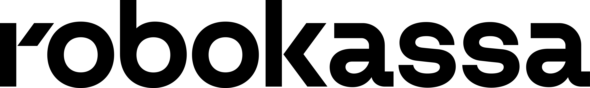

<header class="dlink-hero">

Выставление счетов

<h1 class="dlink-hero__title">Как создать разовую платёжную ссылку</h1>

Счёт-ссылка позволяет принять оплату без сайта — вы отправляете клиенту ссылку, он оплачивает заказ на платёжной странице Robokassa. Разовые (динамические) ссылки работают до первого покупателя.

</header>

## Как создать ссылку {: #kak-sozdat-ssylku }

Пошаговая инструкция в личном кабинете (login.robokassa.ru)

Шаг 1. Авторизация

Войдите в личный кабинет Robokassa по адресу <b>login.robokassa.ru</b>. После входа вы окажетесь на главной странице.

<header class="dlink-lk-ui-header">

<nav class="dlink-lk-ui-nav">
Главная
Центр продаж
</nav>

A

</header>

(Главный экран после входа)

Шаг 2. Раздел «Сервисы»

В левом боковом меню раскройте раздел <b>«Сервисы»</b> и выберите пункт <b>«Выставление счетов»</b>.

<aside class="dlink-lk-ui-sidebar">

Управление 

Сервисы 

Выставление счетов

Платежный виджет

Подписки

Дополнительные сервисы

Бонусы и акции

Центр продаж

</aside>
<main class="dlink-lk-ui-main" style="background: #f8f9fa;"></main>

Шаг 3. Заполнение данных

Убедитесь, что выбран нужный магазин (справа от заголовка). По умолчанию установлен последний активированный. Укажите наименование товара и стоимость. При необходимости нажмите <b>«+ Добавить позицию»</b>.

<aside class="dlink-lk-ui-sidebar">

Сервисы 

Выставление счетов

</aside>
<main class="dlink-lk-ui-main" style="padding: 0;">

Новый счёт

Robokassa.com "Test 2" ▼

Наименование товара/услуги

Курс по вязанию

Стоимость

1 500 ₽

<button class="dlink-btn dlink-btn--outline" style="font-size: 12px; padding: 6px 12px;">+ Добавить позицию</button>

<button class="dlink-btn dlink-btn--green">Выставить счёт</button>

</main>

Шаг 4. Готовая ссылка

Счёт успешно выставлен. Теперь вы можете скопировать ссылку или отправить её клиенту прямо из интерфейса.

<header class="dlink-lk-ui-header">

</header>

<main class="dlink-lk-ui-main" style="padding: 0;">

Выставление счетов

<h3 style="color: #0f172a; font-weight: 600; font-size: 18px; margin-bottom: 20px;">Счет успешно выставлен!</h3>

Ссылка на оплату счета

https://auth.robokassa.ru/Merchant/Invoice/...
<button class="dlink-btn dlink-btn--outline">Скопировать</button>

<label class="dlink-radio-label"><input type="radio" name="send-method" checked> Отправить на e-mail</label>
<label class="dlink-radio-label"><input type="radio" name="send-method"> Выставить в VK</label>
<label class="dlink-radio-label"><input type="radio" name="send-method"> Через SMS (услуга платная: 9.00 ₽ за SMS)</label>

<input type="text" class="dlink-form-input" placeholder="Введите e-mail" style="flex: 1;">
<button class="dlink-btn dlink-btn--green">Отправить</button>

<a href="#" style="color: #2563eb; font-weight: 500; text-decoration: none;">Назад</a>

</main>

## Способы отправки {: #sposoby-otpravki }

Помимо копирования ссылки, вы можете отправить её клиенту напрямую

📧 Отправить по e-mail

Письмо со ссылкой на оплату придет на указанный адрес электронной почты покупателя.

👥 Выставить в VK

Ссылка приходит от Бота Robokassa. Важно, чтобы телефон покупателя был привязан к его аккаунту VK.

📱 Через SMS

Услуга платная — <b>7 руб. за смс</b>. Стоимость списывается с баланса счёта продавца в ЛК Robokassa.

## Дополнительные параметры {: #dopolnitelnye-parametry }

При создании счёта можно заполнить необязательные поля

Маркировка

Актуально только если вы работаете с «Честный знак» и продаёте маркированные товары. Не нужно заполнять, если к эквайрингу не подключен кассовый аппарат (ККТ).

Номер заказа

Любой ваш внутренний идентификатор (артикул, номер счёта). Помогает найти оплату в истории. На платёжной форме не отображается.

Описание заказа

Что именно оплачивает клиент (товар, услуга, период). Видно на платёжной странице.

Комментарий для сотрудников

Внутренний комментарий, который виден только вам и сотрудникам в ЛК. Клиент его не видит.

Связать аванс или предоплату

Отметьте, если оплата по ссылке является авансом или предоплатой по договору.

SuccessUrl2 / FailUrl2

Дополнительные адреса для перенаправления клиента после успешной или неуспешной оплаты (например, на страницу с материалами).

Опции оплаты

Можно задать, сколько дней будет действовать ссылка, и выбрать язык интерфейса оплаты (Русский или Английский).

## Параметры в чеке {: #parametry-cheka }

Справочная информация для заполнения фискальных данных

Оплата — признак способа расчёта (тег 1214)

<ol>
<li><b>Предоплата 100% (код 3)</b> — полная оплата заранее за будущую поставку/услугу.</li>
<li><b>Предоплата (код 2)</b> — частичная оплата за конкретный товар/услугу до передачи.</li>
<li><b>Аванс (код 1)</b> — деньги внесены заранее без указания конкретных товаров/услуг.</li>
<li><b>Полный расчёт (код 4)</b> — <b>самый популярный вид оплаты.</b> Оплата в момент передачи товара/услуги.</li>
<li><b>Частичный расчёт (код 6)</b> — часть оплачена сразу, остаток в кредит.</li>
<li><b>Передача в кредит (код 5)</b> — товар/услуга переданы без оплаты.</li>
<li><b>Кредит (код 7)</b> — последующие платежи по ранее выданному кредиту.</li>
</ol>

Тип — предмет расчёта для каждой позиции в чеке (тег 1212)

<ol>
<li><b>Товар</b> — физический товар, реализуемый продавцом.</li>
<li><b>Подакцизный товар</b> — товары с акцизами (алкоголь, табак и т.п.).</li>
<li><b>Работа</b> — выполненные работы (ремонт, строительство и т.п.).</li>
<li><b>Услуга</b> — оказанные услуги (консультации, транспорт и т.п.).</li>
<li><b>Ставка азартной игры</b> — приём ставок в казино, букмекерских конторах.</li>
<li><b>Выигрыш азартной игры</b> — выплата выигрыша по азартным играм.</li>
<li><b>Лотерейный билет</b> — продажа лотерейного билета.</li>
<li><b>Выигрыш лотереи</b> — выплата лотерейного выигрыша.</li>
<li><b>Предоставление результатов интеллектуальной деятельности</b> — лицензии, патенты, ПО.</li>
<li><b>Платёж</b> — денежные платежи (погашение кредитов, займов).</li>
<li><b>Агентское вознаграждение</b> — комиссия агента за посредничество.</li>
<li><b>Составной предмет расчёта</b> — комбинация нескольких типов (товар + услуга).</li>
<li><b>Иной предмет расчёта</b> — всё, что не вошло в другие категории.</li>
<li><b>Имущественное право</b> — передача прав на имущество.</li>
<li><b>Внереализационный доход</b> — прочие доходы (штрафы, бонусы).</li>
<li><b>Страховые взносы</b> — взносы в страховые фонды.</li>
<li><b>Торговый сбор</b> — сбор за торговую деятельность.</li>
<li><b>Туристический налог</b> — курортный/туристический сбор.</li>
<li><b>Финансовый инструмент</b> — ценные бумаги, вклады и др.</li>
</ol>

Налог — ставка НДС для позиции в чеке (тег 1191)

<ol>
<li><b>Без НДС</b> — операции, не облагаемые НДС.</li>
<li><b>НДС 0%</b> — нулевая ставка НДС.</li>
<li><b>НДС +10%</b> — расчётная ставка: сумма НДС входит в цену (цена * 10/110).</li>
<li><b>НДС 10/110</b> — сумма НДС выделена отдельно.</li>
<li><b>НДС +20%</b> — расчётная ставка: сумма НДС входит в цену (цена * 20/120).</li>
<li><b>НДС 20/120</b> — сумма НДС выделена отдельно.</li>
<li><b>НДС +5%</b> — расчётная ставка: сумма НДС входит в цену (цена * 5/105).</li>
<li><b>НДС 5/105</b> — сумма НДС выделена отдельно.</li>
<li><b>НДС +7%</b> — расчётная ставка: сумма НДС входит в цену (цена * 7/107).</li>
<li><b>НДС 7/107</b> — сумма НДС выделена отдельно.</li>
<li><b>НДС +22%</b> — расчётная ставка (с 2026 года): сумма НДС входит в цену (цена * 22/122).</li>
<li><b>НДС 22/122</b> — сумма НДС выделена отдельно (нововведение 2026 года).</li>
</ol>

## Вопросы и ответы {: #faq }

Ответы на частые вопросы по платёжным ссылкам

Как узнать, что оплата по ссылке прошла успешно?

После оплаты:

<ul>
<li>в ЛК, в разделе <b>«Выставление счетов»</b>, у счёта появится статус <b>«Оплачен»</b>;</li>
<li>в разделе <b>«Баланс и вывод средств»</b> сумма отобразится в доступном остатке (с учётом правил зачисления);</li>
<li>при настроенных у магазина <code>ResultURL</code> вы получите техническое уведомление (можно например передавать на e-mail).</li>
</ul>

Также, вы можете подключить уведомления в VK или Telegram. Для этого зайдите в раздел «Центр продаж» в левом меню и найдите подраздел «Подключить уведомления для VK и Telegram».

Что делать, если клиент говорит, что оплатил, а у меня счёт всё ещё «ожидает оплаты»?

Проверьте:

<ul>
<li>статус операции в разделе <b>«Выставление счетов»</b>;</li>
<li>уточните, не было ли у клиента ошибки на платёжной странице (отмена, недостаточно средств, 3-D Secure и т.п.).</li>
</ul>

Если клиент утверждает, что оплата списалась, однако в ЛК у вас отображается статус счёта «Не оплачен» — попросите клиента сделать скриншот оплаты и обратитесь в поддержку в ЛК Robokassa (слева в меню «Поддержка» → «Создать запрос») или напишите в телеграм-бот: <a href="https://t.me/robosupport_bot" target="_blank">@robosupport_bot</a>.

Можно ли изменить сумму или описание уже созданной платёжной ссылки?

Для разовой ссылки после её создания параметры счёта менять нельзя.

Если вы ошиблись в сумме или описании:

<ul>
<li><b>создайте новый счёт</b> с корректными данными;</li>
<li>старую ссылку не используйте.</li>
</ul>

Сколько времени действует разовая платёжная ссылка?

Срок действия зависит от настроек в поле <b>«Опции оплаты»</b> (если вы его заполняли).

Если срок не задавался явно, ссылка действует по умолчанию до тех пор, пока:

<ul>
<li>счёт не будет оплачен;</li>
<li>или не будет отменён/деактивирован со стороны Robokassa или магазина.</li>
</ul>

<button id="dlinkScrollToTopBtn" class="dlink-scroll-top" aria-label="Вернуться наверх">
<svg viewBox="0 0 24 24" width="24" height="24" stroke="currentColor" stroke-width="2" fill="none" stroke-linecap="round" stroke-linejoin="round">
<line x1="12" y1="19" x2="12" y2="5"></line>
<polyline points="5 12 12 5 19 12"></polyline>
</svg>
</button>

