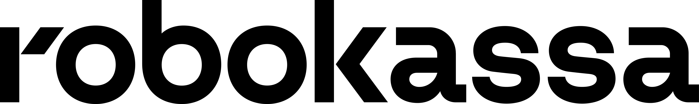

<header class="slink-hero">

Платёжный виджет

<h1 class="slink-hero__title">Как создать многоразовую платёжную ссылку</h1>

Многоразовая (статическая) платёжная ссылка — это постоянная ссылка на оплату фиксированного товара или услуги. Её можно разместить на сайте, в соцсетях, в описании профиля или использовать как QR-код.

</header>

## Как создать ссылку {: #kak-sozdat-ssylku }

Пошаговая инструкция в личном кабинете (login.robokassa.ru)

Шаг 1. Авторизация

Войдите в личный кабинет Robokassa по адресу <b>login.robokassa.ru</b>. После входа вы окажетесь на главной странице.

<header class="slink-lk-ui-header">

<nav class="slink-lk-ui-nav">
Главная
Центр продаж
</nav>

A

</header>

(Главный экран после входа)

Шаг 2. Раздел «Платёжный виджет»

В левом боковом меню раскройте раздел <b>«Сервисы»</b> и выберите пункт <b>«Платёжный виджет»</b>.

<aside class="slink-lk-ui-sidebar">

Управление 

Сервисы 

Выставление счетов

Платёжный виджет

Подписки

Дополнительные сервисы

</aside>
<main class="slink-lk-ui-main" style="background: #f8f9fa;"></main>

Шаг 3. Создание виджета

Выберите нужный магазин и нажмите <b>«Добавить»</b>. Задайте название (по иконке ✏️), выберите способ перехода к оплате, укажите состав заказа и цену.

<aside class="slink-lk-ui-sidebar">

Сервисы 

Платёжный виджет

</aside>
<main class="slink-lk-ui-main" style="padding: 0;">

Платёжный виджет

Robokassa.com "Test 2" ▼

Новый виджет ✏️ 🗑

Способ перехода к оплате

<label class="slink-radio-label"><input type="radio" name="link-type"> Кнопка «Оплатить»</label>
<label class="slink-radio-label"><input type="radio" name="link-type"> Форма с вводом суммы</label>
<label class="slink-radio-label"><input type="radio" name="link-type" checked> Ссылка</label>
<label class="slink-radio-label"><input type="radio" name="link-type"> QR-код</label>
<label class="slink-radio-label"><input type="radio" name="link-type"> Страница с вводом суммы</label>
<label class="slink-radio-label"><input type="radio" name="link-type"> Страница с товарами на выбор</label>

Наименование товара/услуги

Курс "Финансовая Грамотность с нуля"

Цена

9900 ₽

<button class="slink-btn slink-btn--green">Создать</button>

</main>

## Способы перехода к оплате {: #sposoby-perehoda }

В настройках виджета доступно 6 вариантов того, как клиент попадёт на оплату

<svg viewBox="0 0 24 24"><rect x="3" y="8" width="18" height="8" rx="4"/><path d="M12 8v8"/></svg> Кнопка «Оплатить»

Готовая кнопка с дизайном Robokassa, которую можно вставить на свой сайт с помощью HTML-кода (iframe/скрипт). Клиент нажимает на неё и сразу переходит на платёжную страницу. * Требуется наличие сайта

<svg viewBox="0 0 24 24"><rect x="3" y="6" width="18" height="12" rx="2"/><line x1="7" y1="12" x2="17" y2="12"/></svg> Форма с вводом суммы

Клиент сам вводит сумму прямо на вашем сайте. Идеально для донатов, пополнения баланса или частичной оплаты. Генерируется кодом, который нужно разместить на сайте. * Требуется наличие сайта

<svg viewBox="0 0 24 24"><path d="M10 13a5 5 0 0 0 7.54.54l3-3a5 5 0 0 0-7.07-7.07l-1.72 1.71"/><path d="M14 11a5 5 0 0 0-7.54-.54l-3 3a5 5 0 0 0 7.07 7.07l1.71-1.71"/></svg> Ссылка

Обычный URL-адрес. Вы можете отправить его в чат, разместить в соцсетях или на лендинге. Работает бессрочно и подходит для неограниченного числа оплат. * Сумма фиксирована

<svg viewBox="0 0 24 24"><rect x="3" y="3" width="7" height="7"/><rect x="14" y="3" width="7" height="7"/><rect x="14" y="14" width="7" height="7"/><rect x="3" y="14" width="7" height="7"/></svg> QR-код

Сгенерированный QR-код для сканирования телефоном. Удобно для офлайн-точек, листовок или визиток. Ведёт на платёжную страницу с фиксированной суммой. * Сумма фиксирована

<svg viewBox="0 0 24 24"><path d="M14 2H6a2 2 0 0 0-2 2v16a2 2 0 0 0 2 2h12a2 2 0 0 0 2-2V8z"/><polyline points="14 2 14 8 20 8"/><line x1="16" y1="13" x2="8" y2="13"/><line x1="16" y1="17" x2="8" y2="17"/><polyline points="10 9 9 9 8 9"/></svg> Страница с вводом суммы

Ссылка ведёт на отдельную страницу Robokassa, где клиент сначала вводит сумму, а затем оплачивает. Удобно, когда не нужен свой сайт или код.

<svg viewBox="0 0 24 24"><circle cx="9" cy="21" r="1"/><circle cx="20" cy="21" r="1"/><path d="M1 1h4l2.68 13.39a2 2 0 0 0 2 1.61h9.72a2 2 0 0 0 2-1.61L23 6H6"/></svg> Страница с товарами на выбор

Мини-магазин. Клиент видит витрину с вашими товарами/услугами, выбирает нужные позиции (и количество) и оплачивает. Отлично подходит для офлайн-продаж на ярмарках или выставках.

## Дополнительные параметры {: #dopolnitelnye-parametry }

При создании виджета можно заполнить необязательные поля

<svg viewBox="0 0 24 24"><line x1="21" y1="10" x2="3" y2="10"/><line x1="21" y1="6" x2="3" y2="6"/><line x1="21" y1="14" x2="3" y2="14"/><line x1="21" y1="18" x2="3" y2="18"/></svg> Описание заказа

Что именно оплачивает клиент (товар, услуга, период, номер договора и т.п.). Видно на платёжной странице.

<svg viewBox="0 0 24 24"><circle cx="12" cy="12" r="10"/><line x1="2" y1="12" x2="22" y2="12"/><path d="M12 2a15.3 15.3 0 0 1 4 10 15.3 15.3 0 0 1-4 10 15.3 15.3 0 0 1-4-10 15.3 15.3 0 0 1 4-10z"/></svg> SuccessUrl2

Дополнительный адрес, на который клиент будет перенаправлен после успешной оплаты (например, на личный кабинет или страницу с материалами).

<svg viewBox="0 0 24 24"><circle cx="12" cy="12" r="10"/><line x1="12" y1="8" x2="12" y2="12"/><line x1="12" y1="16" x2="12.01" y2="16"/></svg> FailUrl2

Дополнительный адрес для перенаправления при неуспешной оплате (например, страницу с инструкцией по повторной оплате).

<svg viewBox="0 0 24 24"><path d="M5 8l6 6"/><path d="M4 14h6"/><path d="M2 5h12"/><path d="M7 2h1"/><path d="M22 22l-5-10-5 10"/><path d="M14 18h6"/></svg> Язык формы

Можно задать, на каком языке будет отображаться платёжная форма (русский или английский).

## Параметры в чеке {: #parametry-cheka }

Справочная информация для заполнения фискальных данных

Оплата — признак способа расчёта (тег 1214)

<ol><li><b>Предоплата 100% (код 3)</b> — полная оплата заранее за будущую поставку/услугу.</li><li><b>Предоплата (код 2)</b> — частичная оплата за конкретный товар/услугу до передачи.</li><li><b>Аванс (код 1)</b> — деньги внесены заранее без указания конкретных товаров/услуг.</li><li><b>Полный расчёт (код 4)</b> — <b>самый популярный вид оплаты.</b> Оплата в момент передачи товара/услуги.</li><li><b>Частичный расчёт (код 6)</b> — часть оплачена сразу, остаток в кредит.</li><li><b>Передача в кредит (код 5)</b> — товар/услуга переданы без оплаты.</li><li><b>Кредит (код 7)</b> — последующие платежи по ранее выданному кредиту.</li></ol>

Тип — предмет расчёта для каждой позиции в чеке (тег 1212)

<ol><li><b>Товар</b> — физический товар, реализуемый продавцом.</li><li><b>Подакцизный товар</b> — товары с акцизами (алкоголь, табак и т.п.).</li><li><b>Работа</b> — выполненные работы (ремонт, строительство и т.п.).</li><li><b>Услуга</b> — оказанные услуги (консультации, транспорт и т.п.).</li><li><b>Ставка азартной игры</b> — приём ставок в казино, букмекерских конторах.</li><li><b>Выигрыш азартной игры</b> — выплата выигрыша по азартным играм.</li><li><b>Лотерейный билет</b> — продажа лотерейного билета.</li><li><b>Выигрыш лотереи</b> — выплата лотерейного выигрыша.</li><li><b>Предоставление результатов интеллектуальной деятельности</b> — лицензии, патенты, ПО.</li><li><b>Платёж</b> — денежные платежи (погашение кредитов, займов).</li><li><b>Агентское вознаграждение</b> — комиссия агента за посредничество.</li><li><b>Составной предмет расчёта</b> — комбинация нескольких типов (товар + услуга).</li><li><b>Иной предмет расчёта</b> — всё, что не вошло в другие категории.</li><li><b>Имущественное право</b> — передача прав на имущество.</li><li><b>Внереализационный доход</b> — прочие доходы (штрафы, бонусы).</li><li><b>Страховые взносы</b> — взносы в страховые фонды.</li><li><b>Торговый сбор</b> — сбор за торговую деятельность.</li><li><b>Туристический налог</b> — курортный/туристический сбор.</li><li><b>Финансовый инструмент</b> — ценные бумаги, вклады и др.</li></ol>

Налог — ставка НДС для позиции в чеке (тег 1191)

<ol><li><b>Без НДС</b> — операции, не облагаемые НДС.</li><li><b>НДС 0%</b> — нулевая ставка НДС.</li><li><b>НДС +10%</b> — расчётная ставка: сумма НДС входит в цену (цена * 10/110).</li><li><b>НДС 10/110</b> — сумма НДС выделена отдельно.</li><li><b>НДС +20%</b> — расчётная ставка: сумма НДС входит в цену (цена * 20/120).</li><li><b>НДС 20/120</b> — сумма НДС выделена отдельно.</li><li><b>НДС +5%</b> — расчётная ставка: сумма НДС входит в цену (цена * 5/105).</li><li><b>НДС 5/105</b> — сумма НДС выделена отдельно.</li><li><b>НДС +7%</b> — расчётная ставка: сумма НДС входит в цену (цена * 7/107).</li><li><b>НДС 7/107</b> — сумма НДС выделена отдельно.</li><li><b>НДС +22%</b> — расчётная ставка (с 2026 года): сумма НДС входит в цену (цена * 22/122).</li><li><b>НДС 22/122</b> — сумма НДС выделена отдельно (нововведение 2026 года).</li></ol>

## Когда стоит использовать {: #when-to-use }

Статическая ссылка через виджет идеально подходит, если:

<svg viewBox="0 0 24 24"><circle cx="12" cy="12" r="10"/><circle cx="12" cy="12" r="6"/><circle cx="12" cy="12" r="2"/></svg> Фиксированная цена

Услуга или продукт продаются по одной и той же цене (консультация, подписка, пакет услуг).

<svg viewBox="0 0 24 24"><path d="M10 13a5 5 0 0 0 7.54.54l3-3a5 5 0 0 0-7.07-7.07l-1.72 1.71"/><path d="M14 11a5 5 0 0 0-7.54-.54l-3 3a5 5 0 0 0 7.07 7.07l1.71-1.71"/></svg> Одна ссылка для всех

Вам нужна постоянная ссылка, которую можно разместить в шапке профиля, на лендинге, в рассылке.

<svg viewBox="0 0 24 24"><path d="M22 2L11 13"/><path d="M22 2l-7 20-4-9-9-4 20-7z"/></svg> Быстрый запуск

Часто используется, если нужно быстро запустить акцию на определённый товар/услугу в соцсетях.

## Отличия от разовой ссылки {: #differences }

<svg viewBox="0 0 24 24" style="stroke: #ef4444;"><circle cx="12" cy="12" r="10"/><line x1="15" y1="9" x2="9" y2="15"/><line x1="9" y1="9" x2="15" y2="15"/></svg> Разовая ссылка

Привязана к конкретному счёту и перестаёт работать после первой оплаты.

<svg viewBox="0 0 24 24" style="stroke: #10b981;"><path d="M22 11.08V12a10 10 0 1 1-5.93-9.14"/><polyline points="22 4 12 14.01 9 11.01"/></svg> Многоразовая (виджет)

Остаётся активной бессрочно и подходит для неопределённого количества оплат одним и тем же способом.

## Вопросы и ответы {: #faq }

Ответы на частые вопросы по многоразовым ссылкам

Как узнать, кто оплатил по многоразовой ссылке, если у всех одна и та же URL?

В разделе «Операции и возвраты» вы можете отслеживать все успешные транзакции и идентифицировать покупателей по e-mail, которые они оставляют при совершении платежа.

Если нужно собирать более подробную персональную информацию, вы можете реализовать это через Google или Яндекс Формы, а также через форму сбора данных через Telegram или VK бота.

Не забудьте обязательно ознакомиться с законом о защите персональных данных (152-ФЗ), а также разместить политику сбора и обработки персональных данных.

Можно ли поменять цену по многоразовой ссылке?

Да. Цена берётся из настроек платёжного виджета.

Если вы измените сумму в настройках виджета, все последующие оплаты по этой ссылке будут проходить уже по новой цене.

Что делать, если нужно временно остановить приём оплат по многоразовой ссылке?

Откройте настройки платёжного виджета в личном кабинете и обновите виджет, добавив любую новую позицию в счёт (или удалив текущую).

Можно ли использовать одну и ту же многоразовую ссылку на разных площадках?

Да. Одну и ту же ссылку можно разместить одновременно на сайте, в соцсетях, мессенджерах, в e-mail-рассылке и т.д.

Все оплаты будут попадать в один и тот же магазин/виджет, а вы будете видеть их в общей истории платежей.

Можно ли сделать многоразовую ссылку с произвольной суммой (чтобы клиент сам вводил сумму)?

Да, в настройках платёжного виджета можно выбрать режим с вводом произвольной суммы. Этот вариант удобно использовать для пожертвований, донатов или частичной доплаты.

При создании подобного виджета необходимо наличие любого веб-сайта, так как форма с произвольной суммой создаётся через скрипт.

<button id="slinkScrollToTopBtn" class="slink-scroll-top" aria-label="Вернуться наверх">
<svg viewBox="0 0 24 24" width="24" height="24" stroke="currentColor" stroke-width="2" fill="none" stroke-linecap="round" stroke-linejoin="round">
<line x1="12" y1="19" x2="12" y2="5"></line>
<polyline points="5 12 12 5 19 12"></polyline>
</svg>
</button>

