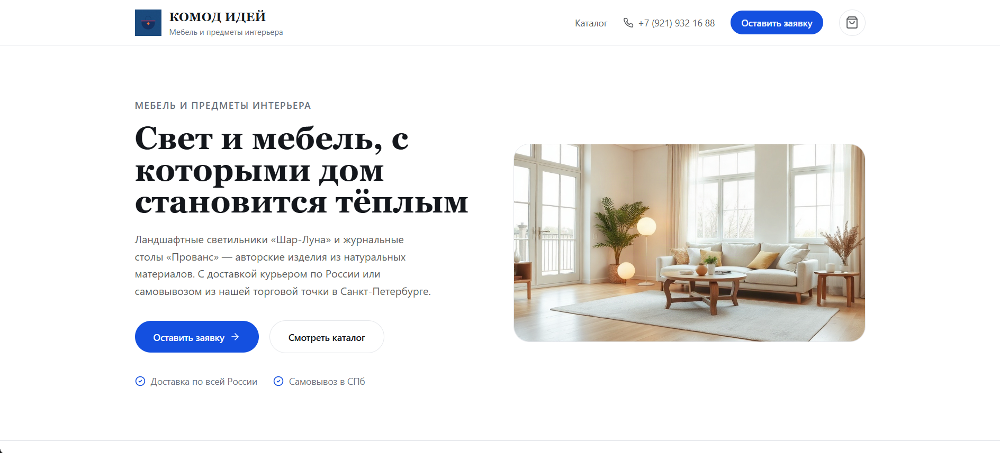
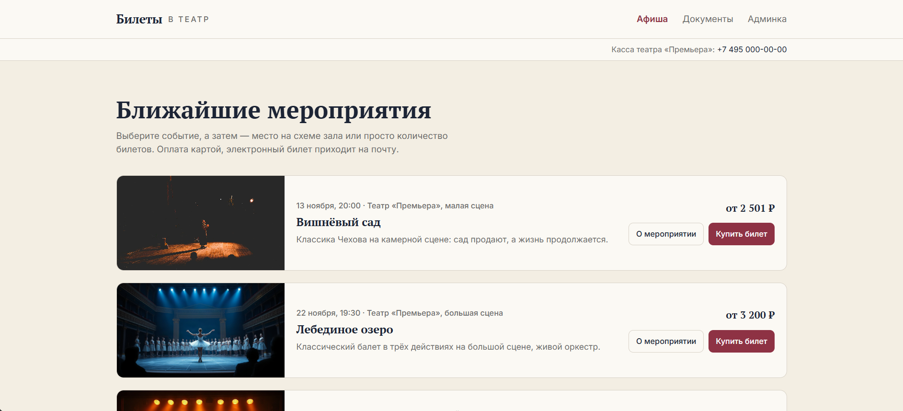
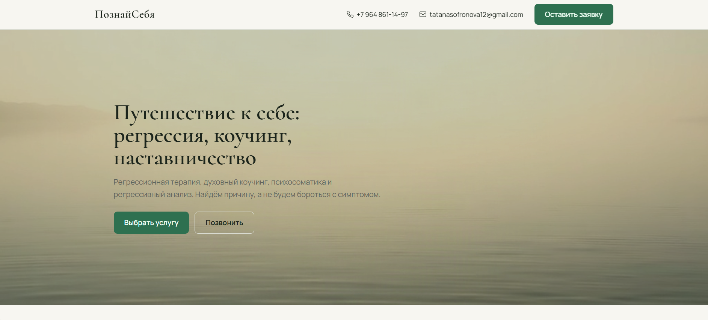
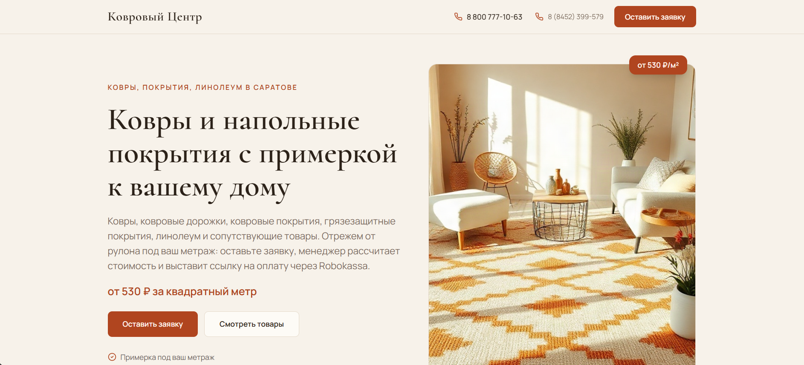
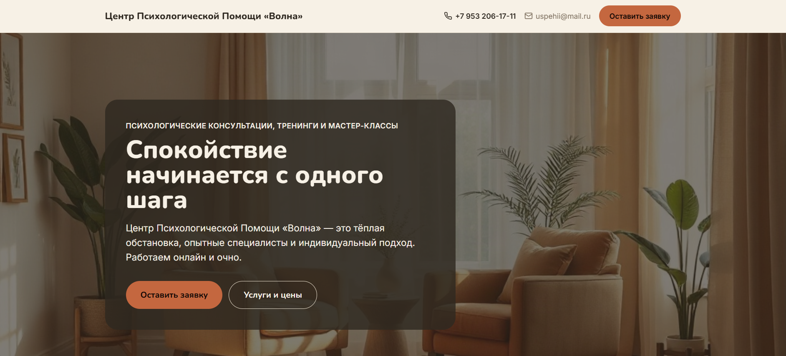

  <header class="audit-hero">
    
Аудит сайта

    <h1 class="audit-hero__title">Требования к сайту для подключения</h1>
    

      Перед подключением Robokassa проверьте, что на вашем сайте или ресурсе есть вся обязательная информация. Это ускорит модерацию и поможет избежать отказа в подключении.
    

  </header>

  

    
!

    

      <strong>Совет:</strong> пройдитесь по всем пунктам ниже, прежде чем подавать заявку. Это сэкономит вам несколько дней на доработках и переписке с поддержкой.
    

  

  

    <h2>Три общих правила</h2>
    
На сайте должны быть расположены:

  

  

    <!-- Правило 1 -->
    

      
01

      

        <h3>Название и цены на товары/услуги</h3>
        
Если у товаров/услуг нет фиксированных цен, их можно указать от и до.

        

          <strong>Пример:</strong> «Юридические услуги от 10 000 до 50 000 рублей».
        

      

    

    <!-- Правило 2 -->
    

      
02

      

        <h3>Оферта ИЛИ условия оплаты и возврата</h3>
        
        

          <b>ВАЖНО:</b> Вам не обязательно размещать оферту, если у вас на сайте уже имеется понятное описание условий оплаты и возврата денежных средств.
        

        
Посмотрите на примеры подходящих формулировок для разных типов бизнеса:

        <!-- Примеры оферт (аккордеоны в стиле question) -->
        

          
Пример 1. Продажа товаров онлайн

          

            
<b>Условия оплаты и возврата</b>

            <ul>
              <li>На сайте доступна оплата картой или через СБП и другими платёжными методами через сервис Robokassa.</li>
              <li>Доставка товара происходит с помощью сервиса СДЭК после оплаты заказа. Срок доставки 3-5 рабочих дней.</li>
              <li>Возврат денежных средств возможен в течение 14 дней с момента покупки, если товар имеет заводские характеристики и не имеет дефектов.</li>
            </ul>
          

        

        

          
Пример 2. Продажа онлайн-услуг

          

            
<b>Условия оплаты и возврата</b>

            <ul>
              <li>Оплата производится на сайте картой или через СБП.</li>
              <li>Доступ к курсу/вебинару открывается автоматически на e-mail после оплаты в течение 5 минут.</li>
              <li>Возврат денег возможен при запросе в течение 14 дней, если услуга не была оказана (доступ к материалам не открыт).</li>
            </ul>
          

        

        

          
Пример 3. Продажа офлайн-услуг

          

            
<b>Условия оплаты и возврата</b>

            <ul>
              <li>Бронь сеанса подтверждается 100% предоплатой на сайте картой или через СБП.</li>
              <li>Услуга оказывается в назначенное время по адресу [Адрес].</li>
              <li>Возврат предоплаты возможен при отмене записи не менее чем за 24 часа до начала услуги.</li>
            </ul>
          

        

        

          
Пример 4. Продажа товаров офлайн

          

            
<b>Условия оплаты и возврата</b>

            <ul>
              <li>Товары бронируются через сайт, оплата производится только при получении в магазине наличными или картой.</li>
              <li>Заказ хранится в магазине по адресу [Адрес] в течение 3 дней с момента поступления.</li>
              <li>Возврат товара надлежащего качества возможен в течение 14 дней в любом нашем магазине при наличии чека.</li>
            </ul>
          

        

        <!-- Генератор оферты -->
        

          
Бесплатно

          <h4>Генератор оферты</h4>
          
Если вы решили разместить полноценную оферту, воспользуйтесь нашим бесплатным генератором в ЛК Robokassa:

          <ol>
            <li>Зайдите в <b>ЛК Robokassa</b>;</li>
            <li>Слева в меню найдите ваш магазин в разделе <b>«Магазины»</b>;</li>
            <li>По вашему магазину нажмите на «<b>ⵗ</b>» → <b>«Настройки»</b>;</li>
            <li>На открывшейся странице пролистайте вниз до раздела <b>«Об оферте»</b>, укажите ваш вид деятельности и нажмите <b>«Скачать оферту»</b>.</li>
          </ol>
          
Данный файл можно отредактировать при необходимости и разместить у вас на веб-ресурсе.

        

      

    

    <!-- Правило 3 -->
    

      
03

      

        <h3>Реквизиты компании и контакты</h3>
        
На сайте должны быть актуальные реквизиты и способы связи с вами.

        

          <strong>Пример:</strong>  
		  ИП Иванов Иван Иванович 
		  ИНН: 12345784912 
          Горячая линия: 8 800 800 88 88 
		  E-mail: ivanovaova@yandex.ru
        

      

    

  

  

    <h2>Технические требования</h2>
    
Пройдитесь по списку и отметьте, что уже готово.

  

  <!-- Интерактивный чек-лист -->
  

    <label class="audit-check">
      <input type="checkbox">
      
      Сайт доступен по прямой ссылке без бесконечных редиректов.
    </label>

    <label class="audit-check">
      <input type="checkbox">
      
      Все страницы, связанные с продажей, находятся в пределах одного доменного имени.
    </label>

    <label class="audit-check">
      <input type="checkbox">
      
      Страницы корректно открываются и содержат актуальные данные — тестовые карточки товаров и «заглушки» удалены.
    </label>

    <label class="audit-check">
      <input type="checkbox">
      
      Сайт не находится в стадии разработки и не закрыт от общего доступа.
    </label>

    <label class="audit-check">
      <input type="checkbox">
      
      Если доступ возможен только по авторизации — предоставьте данные для входа и откройте сайт на время проверки.
    </label>

    <label class="audit-check">
      <input type="checkbox">
      
      Для ресурсов 18+ есть страница с указанием возрастного ограничения и механизм подтверждения возраста.
    </label>
  

  

    
i

    

      Если ваш проект временный или сезонный, заранее предупредите поддержку перед отключением сайта или сменой URL.
    

  

  

    <h2>Примеры сайтов</h2>
    
Посмотрите, как могут выглядеть сайты, готовые к подключению (кликните, чтобы открыть):

  

  
      

    <!-- Сайт 1 -->
    <a href="https://komod-idey.skatoolka.ru/" target="_blank" rel="noopener noreferrer" class="audit-portfolio__item">
      

      

        
      

      

        komod-idey.skatoolka.ru
        
→

      

    </a>

    <!-- Сайт 2 -->
    <a href="https://robokassa-bilety-gvtjjv.skatoolka.ru" target="_blank" rel="noopener noreferrer" class="audit-portfolio__item">
      

      

        
      

      

        robokassa-bilety...
        
→

      

    </a>

    <!-- Сайт 3 -->
    <a href="https://poznaysebya-bas1j4.skatoolka.ru" target="_blank" rel="noopener noreferrer" class="audit-portfolio__item">
      

      

        
      

      

        poznaysebya...
        
→

      

    </a>

    <!-- Сайт 4 -->
    <a href="https://kovrovyy-tsentr-dmwd9h.skatoolka.ru/" target="_blank" rel="noopener noreferrer" class="audit-portfolio__item">
      

      

        
      

      

        kovrovyy-tsentr...
        
→

      

    </a>

    <!-- Сайт 5 -->
    <a href="https://volna-psihologicheskaya-is8dc9.skatoolka.ru/" target="_blank" rel="noopener noreferrer" class="audit-portfolio__item">
      

      

        
      

      

        volna-psihologicheskaya...
        
→

      

    </a>
  

